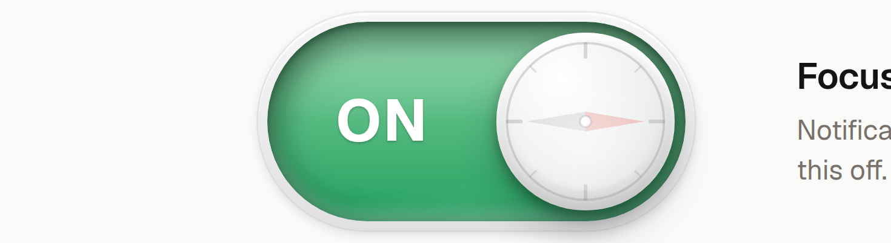
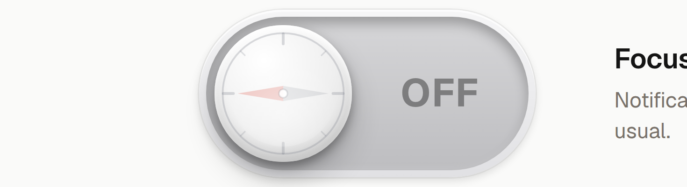
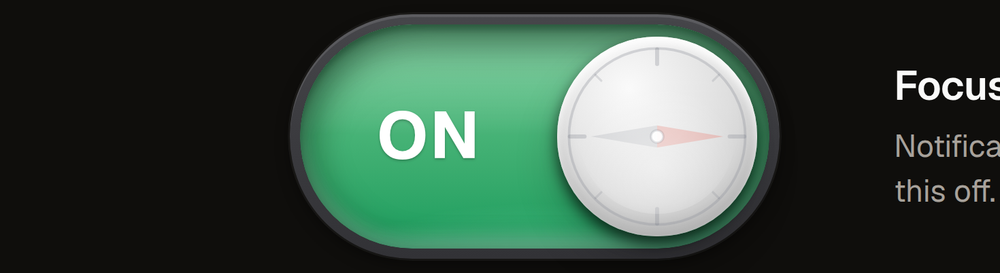

# Gloss Switch

A tactile pill switch for React. A raised casing holds a deep green **ON** well, and a domed knob carries a faint engraved compass whose needle points **west when off** and **east when on**. Click it, press Space, or drag the knob. It is a real checkbox underneath, so it works in forms and with keyboards and screen readers.

Styled with [Sakani UI](https://www.npmjs.com/package/@sakaniui/react) tokens, and the API matches the Sakani `Switch`.

| ON (light) | OFF (light) | ON (dark) |
| --- | --- | --- |
|  |  |  |

## Features

- **Deep ON state.** The track turns into a green well: shaded walls, a glassy sheen on the upper half, and light bouncing back from the bottom. Off is a quiet neutral grey.
- **Engraved compass knob.** The ring and tick marks sit on the very edge of the ball, in pale etched strokes. The needle (a faint warm red north half) swings a half-turn with a spring when the switch changes, and follows the knob live while you drag.
- **Pressed-in feel.** While pressed, the whole switch sinks slightly, the track and casing deepen, and the knob loses its shadow and stretches a touch towards the way it will travel. Everything springs back on release.
- **Drag to toggle.** Drag the knob past the halfway point and let go to commit. A shorter drag springs back.
- **Labels centred in the free space.** `ON` and `OFF` sit exactly midway between the knob and the nearest end of the track, at every size.
- **Four sizes** (`sm`, `md`, `lg`, `xl`), light and dark themes, and a disabled state.
- **Accessible.** A native `<input type="checkbox" role="switch">`, a visible focus ring for keyboard users, and `prefers-reduced-motion` support.

## Getting started

```bash
npm install
npm run dev      # http://127.0.0.1:5178
npm run build
```

The dev server runs a demo page with a large "Focus mode" switch, every size, the disabled states, and a settings list.

## Usage

Copy `src/GlossSwitch.tsx` and `src/GlossSwitch.css` into your project (the component imports its own stylesheet).

```tsx
import { GlossSwitch } from './GlossSwitch';

// Uncontrolled
<GlossSwitch defaultChecked label="Quiet hours" description="Mute alerts from 10 pm to 7 am." />

// Controlled
const [on, setOn] = useState(true);
<GlossSwitch size="xl" checked={on} onChange={(e) => setOn(e.target.checked)} aria-label="Focus mode" />

// Custom labels, no visible label text
<GlossSwitch size="lg" onLabel="LIVE" offLabel="IDLE" aria-label="Broadcast" />
```

If you do not use a visible `label`, pass an `aria-label` so the switch still has an accessible name.

### Props

`GlossSwitch` accepts every attribute of a native `<input>` (except `type` and `size`), and forwards a `ref` to the input.

| Prop | Type | Default | Description |
| --- | --- | --- | --- |
| `checked` | `boolean` | | Controlled value. Pair it with `onChange`. |
| `defaultChecked` | `boolean` | `false` | Initial value when uncontrolled. |
| `onChange` | `ChangeEventHandler<HTMLInputElement>` | | Fires with the native change event for clicks, Space and drags alike. |
| `size` | `'sm' \| 'md' \| 'lg' \| 'xl'` | `'md'` | `sm` 28px high, `md` 40px, `lg` 64px, `xl` 120px. Everything scales as one piece. |
| `label` | `string` | | Text shown to the right of the switch. |
| `description` | `ReactNode` | | Help text under the label. |
| `onLabel` | `string` | `'ON'` | Text in the track when on. Hidden at `sm`. |
| `offLabel` | `string` | `'OFF'` | Text in the track when off. Hidden at `sm`. |
| `disabled` | `boolean` | `false` | Dims the switch and ignores all input. |
| `className` | `string` | | Added to the root `<label>`. |

### Interaction

| Input | Result |
| --- | --- |
| Click or tap | Toggles. |
| Space (when focused) | Toggles. |
| Drag the knob | Follows your pointer. Releasing past the halfway point commits, otherwise it springs back. |
| Press and hold | The press-in look and a slight stretch of the knob. |

## Theming

The component is sized in `em`, so set `font-size` on `.gsw-ui` to resize it freely. Colours come from Sakani UI tokens, each with a plain fallback, so it also works without Sakani UI:

| Token | Used for | Fallback |
| --- | --- | --- |
| `--color-success-solid` | The green ON well | `#12b76a` |
| `--color-border-focus` | Keyboard focus ring | `#2e90fa` |
| `--color-bg-canvas` | Focus ring gap | `#ffffff` |
| `--color-fg-default` | Label text | `#141414` |
| `--color-fg-muted` | Description text | `#6b6b70` |

Dark theme: add a `dark` class to any ancestor (the demo puts it on the page wrapper). The casing, track and knob are tuned separately for dark.

The casing and knob use a set of local custom properties defined on `.gsw` (`--rim-*`, `--off-*`, `--on-*`, `--knob-*`) in `src/GlossSwitch.css`, which you can override for your own palette.

## Project structure

```
src/
  GlossSwitch.tsx   the component (a checkbox, the track, the knob and the compass)
  GlossSwitch.css   all component styles, themes and motion
  App.tsx           demo page
  app.css           demo page styles only
  main.tsx          entry: fonts, Sakani tokens and styles, demo
docs/               screenshots used in this README
```

## Tech

React 19, TypeScript, Vite 8, and `@sakaniui/react` 0.9 for the tokens, the theme toggle in the demo, and parity with its `Switch` API.

## Notes

- Motion is pure CSS (custom properties and transitions), so there is no animation library.
- The knob position is driven by a single `--p` value from 0 to 1. The knob, the green well, the labels and the compass needle all derive from it, which is why dragging stays in sync across all of them.
